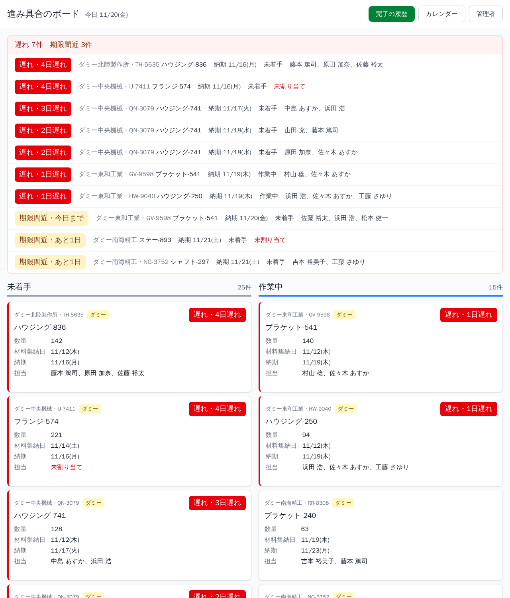
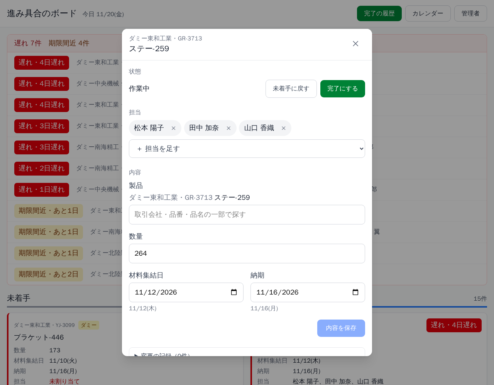
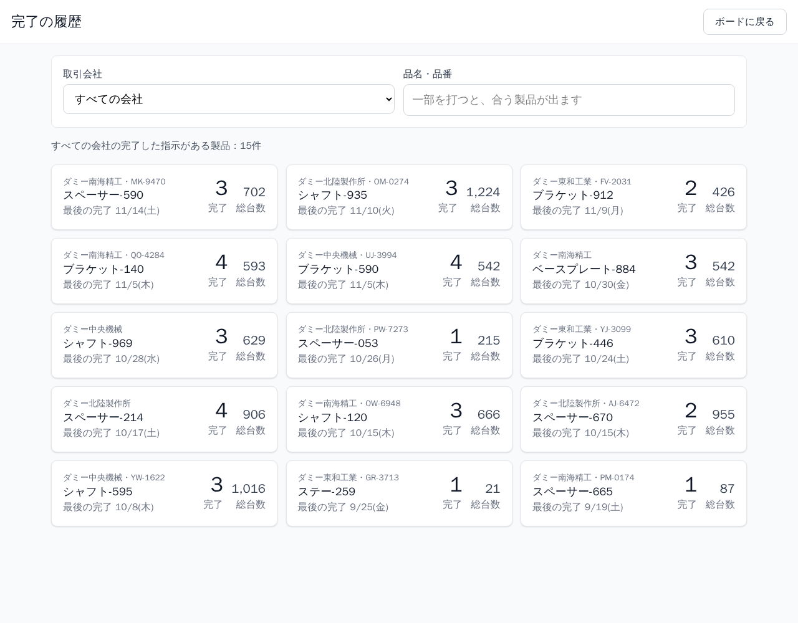
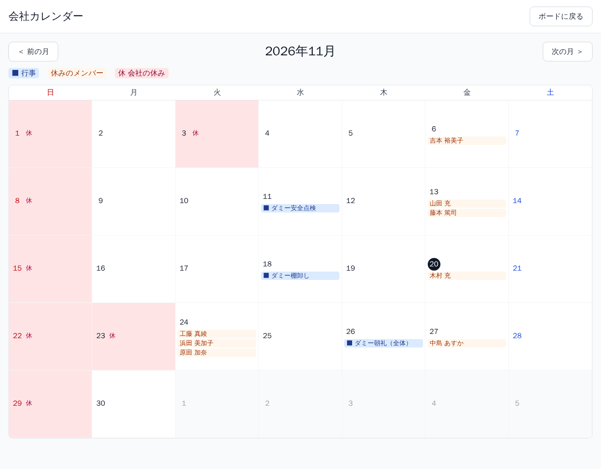
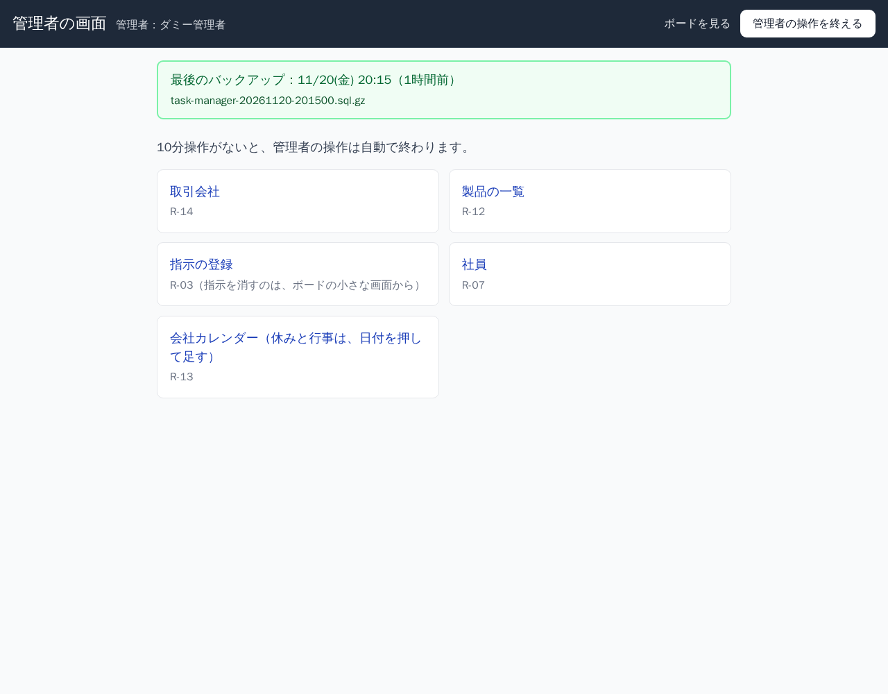
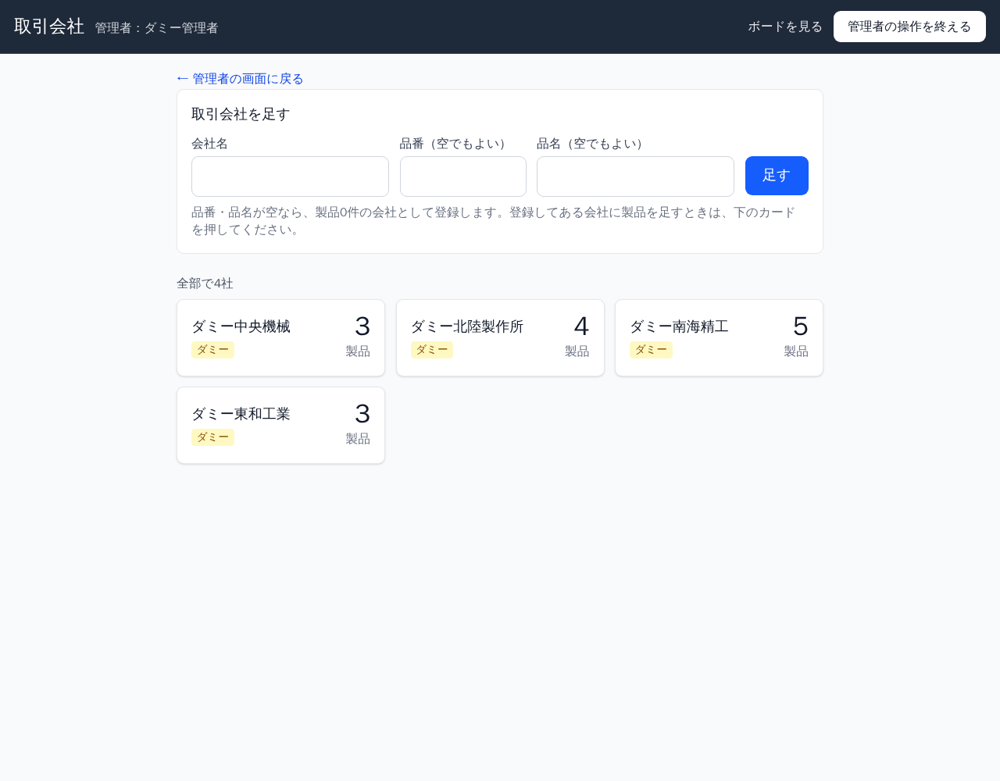

# タスクマネージャー（task-manager）

[](https://github.com/kazuyuki-a-dev/task-manager/actions/workflows/ci.yml)

約20人の製造業の職場で、「だれが何をやっているか」と「締め切り」がひと目で分かり、遅れる前に気づけるようにするタスク管理アプリです。今は Excel で管理している製造の指示を置きかえることを目指して、サンプルとして作りました（会社の本番では使っていません）。

## お試し用のデモ

**https://task-manager-6877.onrender.com**

ダミーデータだけのデモです。登録しなくても触れます。15分アクセスがないと眠るので、はじめに開くと1分ほどかかります。管理者の画面には「ダミー管理者／パスワード password」で入れます。触った内容は、しばらくすると元に戻ります。くわしくは [docs/demo.md](docs/demo.md)。

## こんな画面です

写真に写っている会社・製品・人の名前は、すべてダミーです。

### 1. 進み具合のボード（アプリを開くと、まずこの画面）

職場の共用のタブレットや PC で開いておく画面です。いちばん上に、**遅れている指示と、納期が近い指示**を赤と黄色でまとめて出します。その下に、「未着手」と「作業中」の指示をカードで並べます。だれが担当しているかも、ひと目で分かります。



### 2. 指示を押すと、小さな画面が開く

カードを押すと、その指示の小さな画面が開きます。ここで、**作業を始める・完了にする・担当を足す・数量や納期を直す**ができます。ログインはいりません。担当が決まっていない指示は、作業を始められないようにしています。



### 3. 完了の履歴

完了した指示を、製品ごとにまとめて見られます。取引会社でしぼったり、品名や品番の一部で探したりできます。製品を押すと、完了した指示の納期と台数が並び、「作業者」を押すと、だれが作業したかが出ます。



### 4. 会社カレンダー

会社の休み（赤いマス）、行事（青）、休むメンバーの名前（オレンジ）を、月のカレンダーで見られます。休みと行事を足すのは管理者だけです。



### 5. 管理者の画面

ボードの右上の「管理者」から、パスワードを入れて入ります。指示の登録、取引会社と製品、社員、会社カレンダーの休みと行事を管理します。いちばん上に、**最後にバックアップをとった日時**が出ます（1日以上とれていないと赤になります）。





## 動かし方

Docker と PHP 8.3 以上、Composer が必要です。

```sh
git clone https://github.com/kazuyuki-a-dev/task-manager.git
cd task-manager
composer install
cp .env.example .env
./vendor/bin/sail up -d
./vendor/bin/sail artisan key:generate
./vendor/bin/sail artisan migrate --seed   # --seed でダミーデータも入る
./vendor/bin/sail npm install
./vendor/bin/sail npm run build
```

http://localhost を開くと画面が出ます。

画面を直しながら確かめるときは、`npm run build` のかわりに `./vendor/bin/sail npm run dev` を動かしておくと、保存するたびに画面に反映されます。

管理者の画面は、ボードの右上の「管理者」から入ります。ダミーデータの管理者は「ダミー管理者」、パスワードは `password` です（開発用のダミーだけ。本番では使わない）。

テスト：`./vendor/bin/sail test`

## 資料

| 資料 | 中身 |
|---|---|
| [要件定義書](docs/requirements.md) | 目的、優先度、完成の境界、要件の対応表 |
| [決めたことの記録](docs/decisions.md) | 決めたことと、その理由 |
| [運用の手順書](docs/operations.md) | バックアップのしくみと戻し方（本番は行わないので、手元の開発環境での記録） |
| [バックアップと復元の手順書](docs/backup-and-recovery.md) | ターミナルに打つものまで書いた、ステップ方式の手順（PC がこわれたときの戻し方も） |
| [お試し用のデモ](docs/demo.md) | Render の無料プランで公開するデモの設定の手順、環境変数、確かめ方、戻し方 |
